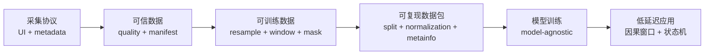

# IMU 数据系统总览

## 系统目标



## Task 1：采集前端、传感器数据、实时可视化

已实现：

- 真实串口与无硬件 Demo 两种数据源；
- 两路 MPU6050、12 通道实时波形；
- 采样率、样本数、缺失帧和进度实时显示；
- 被试、左右手、惯用手、传感器布局元数据；
- 倒计时、批量 trial、采集间隔；
- trial 自动质量判定；
- 合格/不合格数据分流；
- 自动 session manifest。

证据：

```text
imu_real_batch_recorder.py
imu_quality.py
collection_config.json
```

## Task 3：数据质量、划分、增强和训练输入

### 质量控制

- 采样率与时长；
- 缺帧、重复帧和乱序帧；
- 传感器饱和；
- 时间戳 jitter；
- 同类近似重复；
- `accepted / review / rejected` 分级。

### 预处理

- 原始计数转换为 SI 单位；
- 按 device timestamp 对齐到统一 50 Hz；
- 事件感知窗口；
- 固定 `50 × 12` 输入；
- 保留 `visible_mask` 和有效长度。

### 增强

- 时间弯曲与平移；
- 随机裁剪；
- Gaussian noise；
- 轻微低通差异；
- 两 IMU 时间错位；
- 连续丢帧与 sample-and-hold；
- 单通道短时掉线；
- 单 IMU 短时中断；
- 三维旋转、增益和 gyro bias。

增强只用于训练集，配置集中在 `augmentation_config.json`，由轻量 NumPy registry 执行。

## Task 4：向下游和实时系统交付

### 冻结数据接口

```text
train.npz
validation.npz
test.npz
normalization.npz
metainfo.json
label_map.json
splits.json
checksums.sha256
```

每个 split 同时提供：

```text
x             sequence tensor
y             class labels
mask          visible channels
length        valid steps
features      optional summary features
source_id     stable trial identity
dataset_id    package version
```

下游可使用特征模型或序列模型，不绑定具体网络结构。

### 实时边界

- 离线流程可使用完整 trial 和中心窗口；
- 在线流程只使用过去样本；
- `realtime_buffer.py` 提供因果环形窗口；
- 目标端到端延迟为 100–200 ms；
- 连续运动优先用姿态直接控制；
- 分类模型用于抓取、释放、切换等离散事件。

## Bonus：通信损坏与传感器鲁棒性

- 连续丢帧；
- sample-and-hold；
- 单通道掉线；
- 单 IMU 中断；
- 时间错位；
- noise 与滤波差异；
- 所有缺失位置通过 visible mask 显式标记。

## 证据与展示材料

- `PIPELINE_ARCHIVE.md`：完整数据流程图；
- `data_review/DATA_DESIGN_REVIEW.md`：质量、split 和增强证据；
- `data_review/split_composition.png`：真实/增强在 split 中的组成；
- `data_review/class_balance.png`：类别覆盖；
- `data_review/quality_overview.png`：采样率与时长质量；
- `data_review/augmentation_example.png`：同一来源增强与 mask；
- `DATASET_CONTRACT.md`：下游读取合同；
- `REALTIME_CONTRACT.md`：实时延迟和因果窗口约束。

## 当前数据事实

- 74 条真实 trial；
- 8 类动作；
- 训练集 45 条真实 + 135 条增强；
- validation 13 条真实；
- test 16 条真实；
- validation/test 不含合成数据；
- 三个 split 的来源无重叠。

## 明确边界

- 当前只有一名被试；
- `grasp/release` 各只有两条真实 trial；
- 地址与手指映射仍待确认；
- 实时串口尚未完成最终硬件联调；
- 离线中心窗口不能直接当作在线低延迟窗口。
