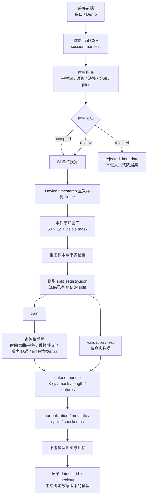

# 数据采集与数据集流水线归档

归档日期：2026-11-04

## 总流程



## 关键规则

1. 先按原始 trial 分组划分，再做增强。
2. validation 和 test 只使用真实记录。
3. 新增真实数据时生成新的 `dataset_vNNN`，不覆盖旧版本。
4. `split_registry.json` 固定已有 trial 的 split，保证新旧模型可比。
5. 下游结果必须记录 `dataset_id` 和 checksum。
6. 数据包同时提供序列张量和可选统计特征，模型结构不受限制。

## 在线推理边界

数据集流程与实时执行流程必须分开：

```text
离线训练：
完整 trial → 中心事件窗口 → 增强 → 训练/验证/测试

实时执行：
流式样本 → 因果环形窗口 → 固定预处理 → 推理
→ 阈值/平滑/状态机 → 机械臂或游戏
```

在线端不能：

- 等待未来 0.5–1 秒的数据再输出；
- 执行训练专用数据增强；
- 重新拟合 normalization；
- 直接使用离线中心窗口而不检查因果性。

目标端到端延迟建议控制在 100–200 ms，可接受上限约 250 ms。
详细约束见 `REALTIME_CONTRACT.md`。

## 采集与质量控制

采集前端默认兼容旧协议：

```text
采样率：50 Hz
波特率：38400
单次时长：1 秒，可调整
每组 trial：10 次，可调整
准备倒数：3 秒
trial 间隔：0 秒，可调整
```

当前固定传感器布局：

```text
左手：食指 + 拇指
地址映射：0x68/0x69 对应关系待确认
```

质量检查项：

- 采样率；
- 样本数和持续时间；
- 缺帧、重复帧、乱序帧；
- 传感器饱和；
- 时间戳 jitter；
- 同类窗口相似度和相对 RMS 差异。

质量结果：

```text
accepted / review / rejected
```

## 当前数据集

原始真实记录共 74 条：

```text
idle      10
forward   10
backward  10
left      10
right     10
grasp      2
release    2
other     20
```

`dataset_v002` 当前内容：

```text
train：      45 真实 + 135 增强 = 180
validation： 13 真实 + 0 增强  = 13
test：       16 真实 + 0 增强  = 16
```

已验证：

- 三个 split 的原始 trial 来源互不重叠；
- validation/test 没有增强数据；
- checksum 加载校验通过。

## 交付目录

```text
dataset_v002/
├── train.npz
├── validation.npz
├── test.npz
├── normalization.npz
├── label_map.json
├── feature_names.json
├── metainfo.json
├── splits.json
├── manifest.csv
├── quality_report.csv
├── duplicate_report.csv
├── augmented_manifest.csv
├── README.md
└── checksums.sha256
```

每个 split NPZ：

```text
x            N × 50 × 12
y            N
mask         N × 50 × 12
length       N
features     N × 84
source_index 数据集内索引
source_id    跨版本稳定 trial ID
is_synthetic 增强标记
class_names
channel_names
feature_names
dataset_id
```

## 代码入口

| 文件 | 作用 |
|---|---|
| `imu_real_batch_recorder.py` | 可视化采集、Demo、质量门禁和 session manifest |
| `collection_config.json` | 手势、传感器布局、默认协议和波特率 |
| `imu_quality.py` | trial 质量规则 |
| `imu_processing.py` | 时间重采样、事件窗口、特征、重复检测和 split |
| `imu_augmentations.py` | 训练集增强与 mask |
| `build_dataset.py` | 构建冻结数据集 |
| `load_dataset.py` | 下游加载并校验数据集 |
| `split_registry.json` | 冻结既有 trial 的 split |

## 常用命令

无硬件演示：

```cmd
python imu_real_batch_recorder.py --demo
```

真实采集：

```cmd
python imu_real_batch_recorder.py --port COMx
```

构建新数据版本：

```cmd
python build_dataset.py --output dataset_v002
```

下游加载：

```python
from load_dataset import load_split

train = load_split("dataset_v002", "train")
X = train["features"]      # 可选特征输入
y = train["y"]

# 或使用序列输入
sequence = train["x"]
mask = train["mask"]
length = train["length"]
```

## 持续采集闭环

```text
新增真实 trial
→ 质量检查
→ build_dataset.py --output dataset_vNNN
→ 下游重新训练
→ 记录 dataset_id、checksum 和模型版本
→ 在固定旧测试集与扩展测试集上比较
```

## 已知限制

- 当前只有 `subject01`，不能评价跨用户泛化；
- `grasp/release` 各只有 2 条真实数据；
- validation 中 `grasp/release` 为空，test 中各有 1 条；
- 两个 I²C 地址与食指/拇指的对应关系尚未确认；
- 新版前端尚未在真实硬件上完成最终串口联调。
