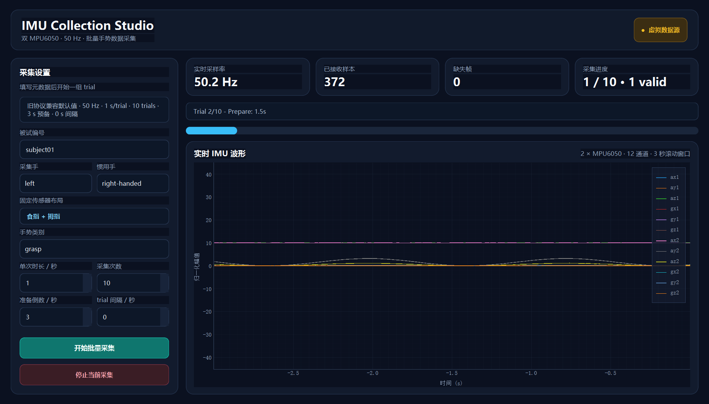
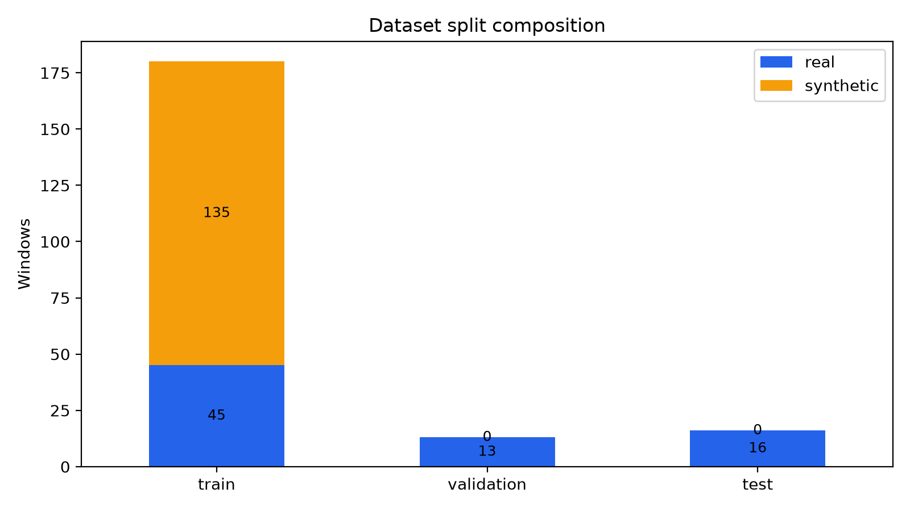
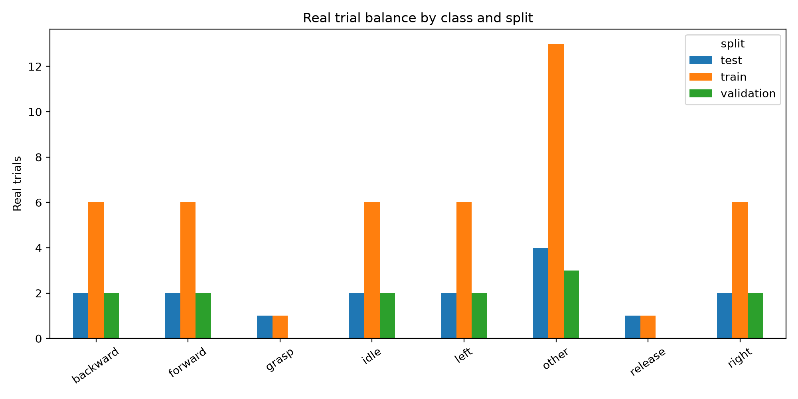
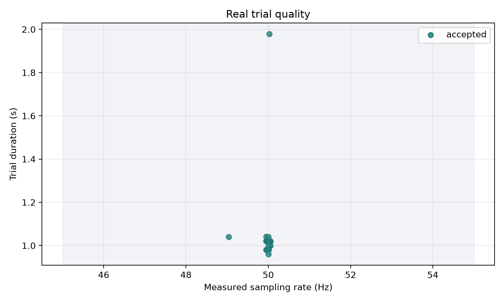
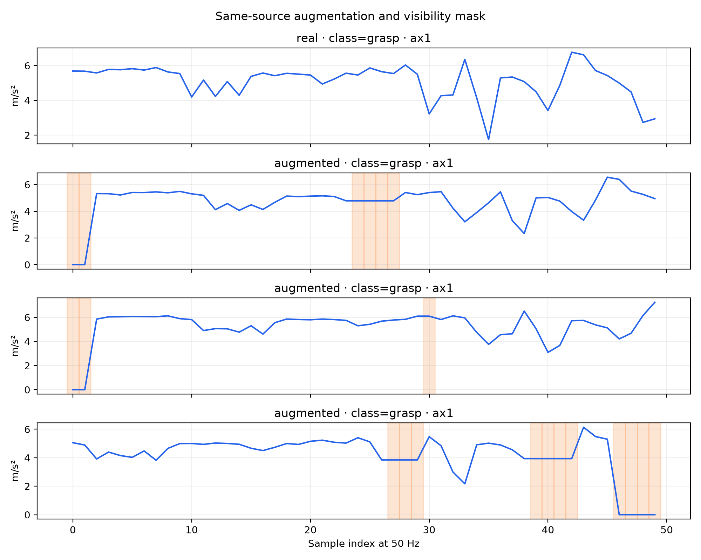

# Data Design Review

## One-line result

The current data package contains **74 unique real trials**, with
**74 accepted**, **0 review**, and **0 rejected**.
Only training receives augmentation; validation and test remain real-only.

## Collection interface



## Split composition



```text
train:      180 total
validation: 13 total
test:       16 total
```

Synthetic counts:

```text
train:      135
validation: 0
test:       0
```

## Class coverage



`grasp` and `release` remain limited by real-data availability. The pipeline
reports that limitation instead of using synthetic copies to hide it.

## Quality evidence



Hard checks cover sampling rate, duration, missing frames, sequence order, and
sensor saturation. Timestamp jitter and near-duplicate similarity are also
recorded.

## Augmentation and missing data



Augmented rows retain their `source_id`, and the model input includes a
visible mask. Validation and test never receive synthetic rows.

## Leakage prevention

- Split is frozen in `split_registry.json`.
- Every split stores stable `source_id`.
- Source sets are checked for overlap during dataset construction.
- Existing trial fingerprints cannot change silently.
- A new data release creates `dataset_vNNN`; old packages remain immutable.

## Task mapping

| Work area | Evidence |
|---|---|
| Task 1 | Collection UI, metadata, real-time 12-channel visualization, Demo mode |
| Task 3 | Quality grading, source-group split, augmentation, normalization, feature export |
| Task 4 | Model-agnostic NPZ contract, checksum loader, causal buffer and latency boundary |
| Robustness | Packet loss, sample-and-hold, one-IMU outage, visible masks, rotation, gain, gyro bias |

## Demo flow

1. Launch `imu_real_batch_recorder.py --demo`.
2. Start one batch and show real-time signal and quality status.
3. Run `build_dataset.py --output dataset_vNNN` for the next data release.
4. Load a split with `load_dataset.py`.
5. Compare the old and new model only after retraining on the new dataset version.

## Explicit limitations

- Only one subject is present.
- `grasp` and `release` have only two real trials each.
- Validation has no real `grasp/release` examples.
- The `0x68/0x69` to index/thumb mapping remains unresolved.
- Real hardware integration still needs a final serial test.
