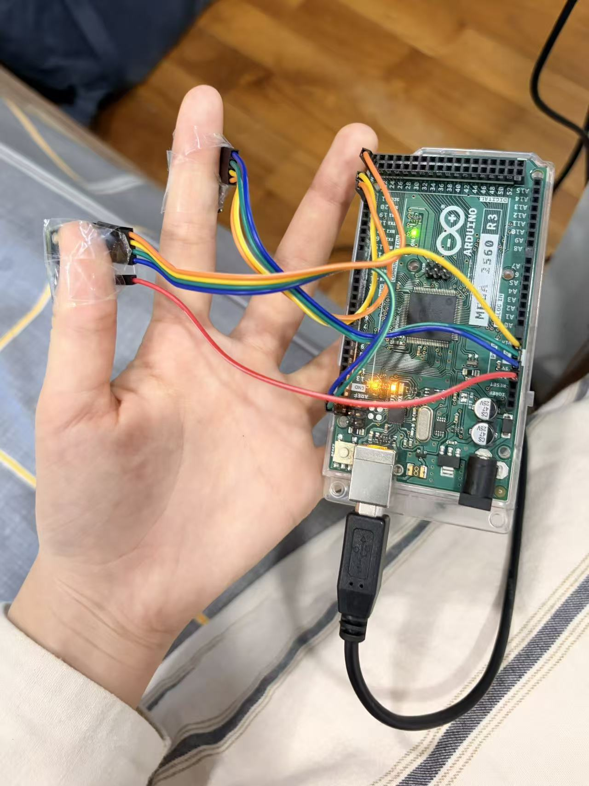
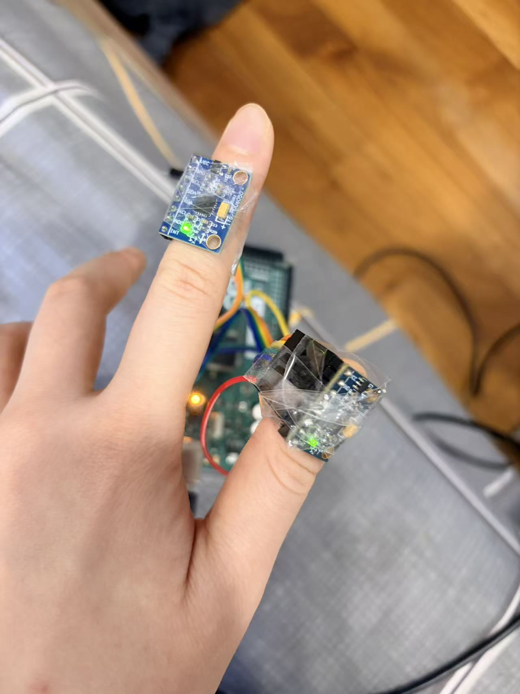
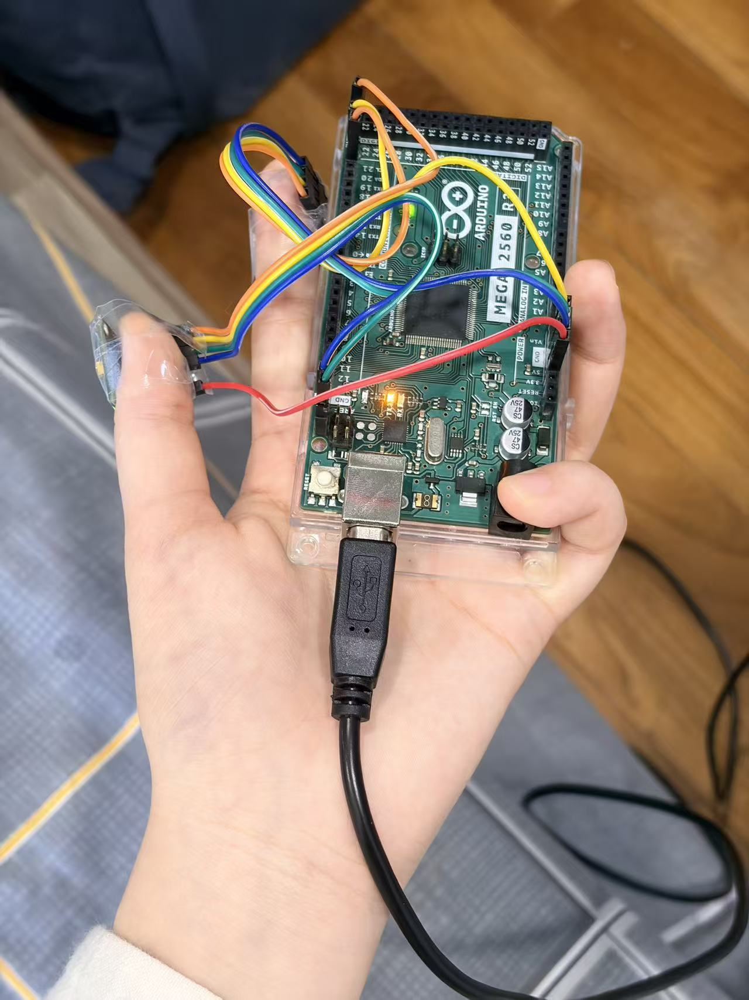
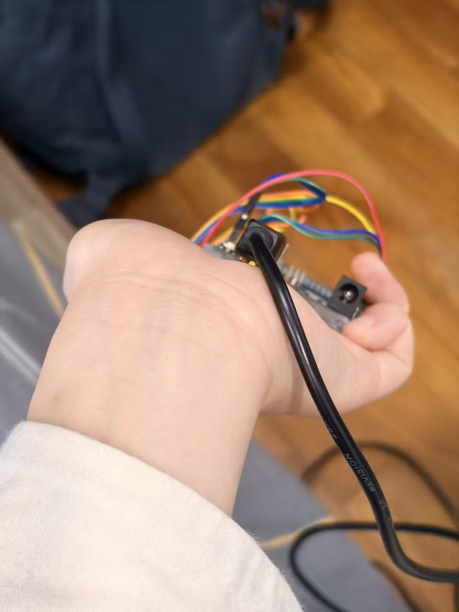
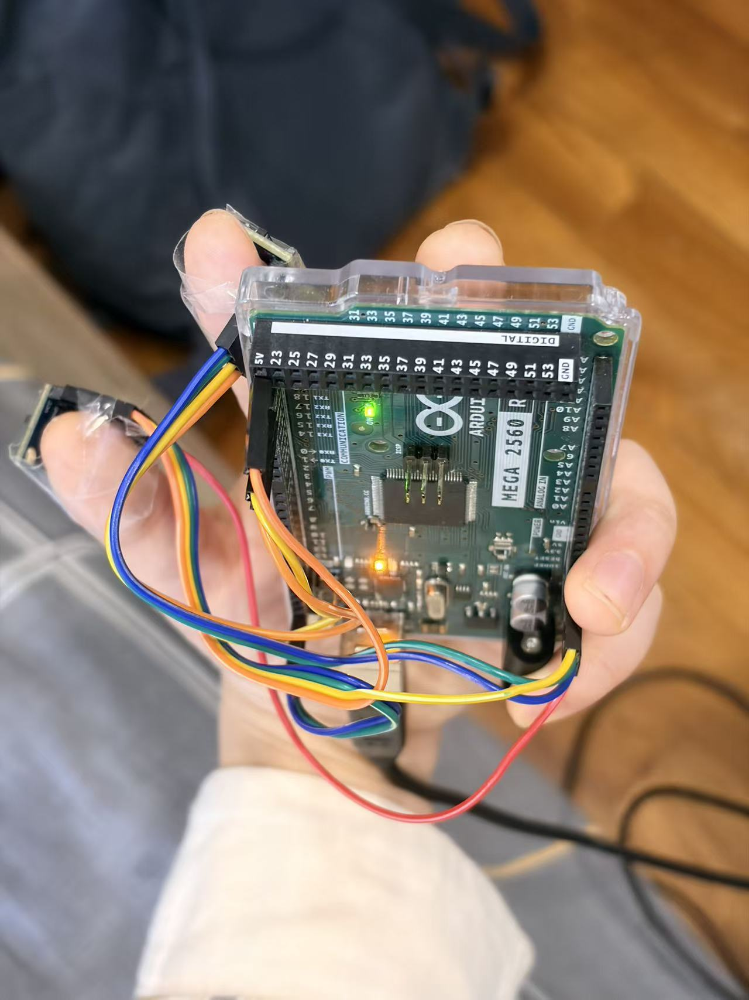
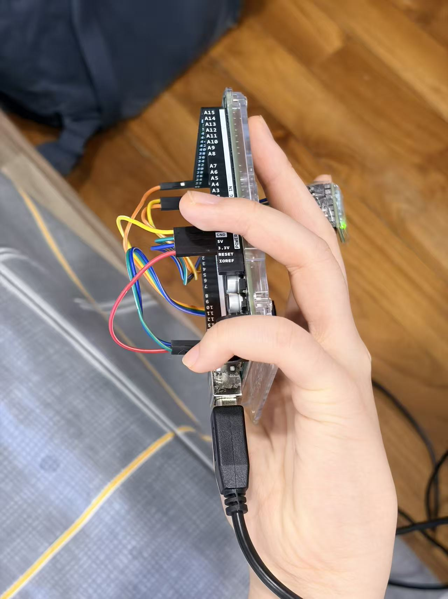
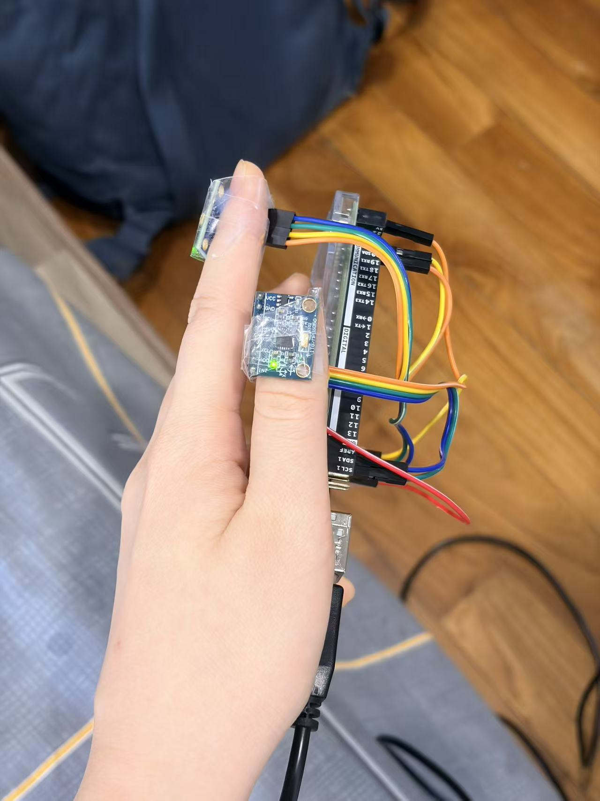

# CEG5205 Final Project — IMU Data Collection

Dual MPU6050 IMU data acquisition, visualization, gesture dataset generation, and analysis.

**Repository:** https://github.com/lxy336/CEG5205_FP_data-collection

## English

### 1. Project Overview

This project uses two MPU6050 sensors connected to an Arduino Mega 2560 to collect 12-channel IMU data at approximately 50 Hz. Python programs are provided for real-time recording, data analysis, augmentation, and visualization.

### 2. Project Structure

```text
CEG5205_FP_Materials/
├── MPU6050_raw/
│   ├── MPU6050_raw.ino
│   ├── MPU6050.cpp
│   ├── MPU6050.h
│   ├── I2Cdev.cpp
│   └── I2Cdev.h
│
├── Python/
│   ├── imu_real_batch_recorder.py
│   ├── analyze_real_imu.py
│   ├── augment_imu_dataset.py
│   ├── imu_augmentations.py
│   ├── imu_processing.py
│   ├── build_dataset.py
│   ├── load_dataset.py
│   ├── realtime_buffer.py
│   ├── make_data_report.py
│   ├── split_registry.json
│   ├── collection_config.json
│   ├── QUICKSTART.md
│   ├── COLLABORATION.md
│   ├── DATASET_CONTRACT.md
│   ├── PIPELINE_ARCHIVE.md
│   ├── REALTIME_CONTRACT.md
│   ├── data_review/
│   │   └── DATA_DESIGN_REVIEW.md
│   ├── prepare_imu_dataset.py
│   ├── train_imu_baseline.py
│   ├── plot_imu_csv.py
│   ├── requirements.txt
│   ├── real_imu_data/
│   ├── augmented_imu_data/
│   ├── real_imu_analysis/
│   └── imu_figures/
│
└── README.md
```

### 3. File Descriptions

| File / Folder | Description |
|---|---|
| `MPU6050_raw/` | Arduino firmware and required sensor libraries. |
| `MPU6050_raw.ino` | Reads two MPU6050 sensors and sends 12-channel data via USB serial. |
| `imu_real_batch_recorder.py` | Real-time visualization, gesture labeling, and batch CSV recording. |
| `analyze_real_imu.py` | Analyzes sampling rate, jitter, and missing frames. |
| `augment_imu_dataset.py` | Legacy fixed-count synthetic-file generator. Do not use its copies across evaluation splits. |
| `imu_augmentations.py` | Label-preserving crop, shift, packet-loss, and sensor-outage augmentations with masks. |
| `imu_processing.py` | Timestamp resampling, event-aware windows, optional summary features, duplicate checks, and split helpers. |
| `build_dataset.py` | Builds versioned split files for any downstream model, with metainfo, normalization, masks, and checksums. |
| `load_dataset.py` | Verifies checksums and loads a frozen train/validation/test split. |
| `realtime_buffer.py` | Provides a causal rolling window for low-latency online inference. |
| `make_data_report.py` | Generates presentation-ready split, quality, and augmentation figures. |
| `split_registry.json` | Persistently freezes existing real trials into their assigned split. |
| `collection_config.json` | Editable gesture labels, sensor layout, protocol defaults, and baud rate. |
| `QUICKSTART.md` | Short end-to-end onboarding guide for a new collector. |
| `COLLABORATION.md` | Data/model workflow, versioning, and branch collaboration rules. |
| `DATASET_CONTRACT.md` | Defines the downstream tensor, label, and normalization contract. |
| `PIPELINE_ARCHIVE.md` | Visual archive of acquisition, quality, preprocessing, splitting, augmentation, and delivery. |
| `REALTIME_CONTRACT.md` | Separates offline training data from causal, low-latency online inference. |
| `prepare_imu_dataset.py` | Converts real CSVs to SI units, fixed windows, masks, source indices, and manifests. |
| `train_imu_baseline.py` | Evaluates a real-data-only scikit-learn baseline with per-recording predictions. |
| `plot_imu_csv.py` | Plots 12-channel IMU signals from a selected CSV file. |
| `real_imu_data/` | Original recordings organized by gesture. |
| `augmented_imu_data/` | Original data copies and synthetic recordings. |
| `real_imu_analysis/` | Sampling analysis results and plots. |
| `imu_figures/` | Generated IMU signal figures. |

### 4. Installation and Usage

Clone the repository:

```bash
git clone https://github.com/lxy336/CEG5205_FP_data-collection.git
cd CEG5205_FP_data-collection/Python
```

Install Python dependencies:

```bash
python -m pip install -r requirements.txt
```

Upload `MPU6050_raw.ino` to the Arduino Mega 2560 using Arduino IDE.

Run the Python programs:

| Task | Command |
|---|---|
| Record IMU data | `python imu_real_batch_recorder.py --port COM5` |
| Run without hardware | `python imu_real_batch_recorder.py --demo` |
| Analyze recordings | `python analyze_real_imu.py` |
| Generate synthetic data | `python augment_imu_dataset.py` |
| Prepare model-ready dataset | `python prepare_imu_dataset.py` |
| Build split dataset | `python build_dataset.py --output dataset_v001` |
| Verify/load frozen split | `python load_dataset.py --split train` |
| Generate data design review | `python make_data_report.py` |
| Train real-data baseline | `python train_imu_baseline.py` |
| Plot IMU signals | `python plot_imu_csv.py` |

For plotting, pass the CSV filename or full path:

```bash
python plot_imu_csv.py sample.csv --no-show
```

`--demo` starts a virtual 50 Hz dual-IMU source. The countdown, batch recording,
12-channel plot, metadata fields, and CSV output are the same as in hardware mode,
which makes it possible to develop and demonstrate the collection workflow without
an Arduino connected. Demo recordings are saved under `demo_imu_data/`, never in
the real training directory.

### Legacy-compatible collection defaults

- Sampling rate: 50 Hz.
- Trial duration: 1 second by default and adjustable per batch.
- Batch size: 10 trials by default and adjustable per batch.
- Preparation countdown: 3 seconds.
- Rest between trials: 0 seconds by default and adjustable per batch.
- Required metadata: subject, hand side, and handedness.
- Sensor layout is fixed in the UI as index finger + thumb. The exact
  `0x68/0x69` address mapping remains pending.
- A valid trial needs 45–55 samples, 0.9–1.1 s duration, 45–55 Hz measured rate,
  no sequence gaps, and no sensor saturation.
- Invalid trials are saved under `rejected_imu_data/`.
- Every trial is appended to a session manifest under
  `real_imu_data/_sessions/`; demo sessions use `demo_imu_data/_sessions/`.

### 5. Configuration

- Board: Arduino Mega 2560
- Sensors: 2 × MPU6050
- I²C addresses: `0x68`, `0x69`
- Serial port: `COM5` (change according to your computer)
- Baud rate: `38400` (kept compatible with the existing firmware)
- Target sampling rate: `50 Hz`
- Gesture classes: `idle`, `forward`, `backward`, `left`, `right`, `grasp`, `release`, `other`
- Recording metadata: `hand_side`, `handedness`, `sensor_positions`,
  `address_mapping`
- Existing `subject01` data: left hand; IMUs mounted on the index finger and thumb.
- The mapping from `0x68/0x69` to index/thumb is not documented and must be confirmed.


**Note:** Synthetic recordings are intended for training augmentation. Model evaluation should use independent real recordings.


## Hardware Setup & Gesture Demonstration


### Hardware Setup

Two MPU6050 sensors are connected to an Arduino Mega 2560.

<table>
  <tr>
    <th align="center">Front View</th>
    <th align="center">Back View</th>
  </tr>
  <tr>
    <td align="center">
      
    </td>
    <td align="center">
      
    </td>
  </tr>
</table>


### Gesture Demonstration

The following images show five example hand gestures.

| Idle | Forward | Backward |
|---|---|---|
|  |  |  |

| Left | Right |
|---|---|
|  |  |


---

## 中文

### 1. 项目简介

本项目使用 Arduino Mega 2560 连接两个 MPU6050 传感器，以约 50 Hz 的频率采集 12 通道 IMU 数据。

Python 程序用于实时数据采集、手势标注、数据分析、数据增强和信号可视化。

### 2. 文件说明

| 文件 / 文件夹 | 功能 |
|---|---|
| `MPU6050_raw/` | Arduino 程序及所需传感器库。 |
| `MPU6050_raw.ino` | 读取两个 MPU6050，并通过 USB 串口发送 12 通道数据。 |
| `imu_real_batch_recorder.py` | 实时绘图、动作标注、批量采集并保存 CSV。 |
| `analyze_real_imu.py` | 分析采样频率、采样抖动和丢帧情况。 |
| `augment_imu_dataset.py` | 旧版固定数量合成文件生成器；其副本不能跨训练/测试划分使用。 |
| `imu_augmentations.py` | 标签保持的裁剪、平移、丢包和单传感器中断增强，并返回可见性 mask。 |
| `imu_processing.py` | 时间轴重采样、事件感知窗口、可选统计特征、重复检测和 split 工具。 |
| `build_dataset.py` | 生成适用于任意下游模型的 split、mask、normalization、metainfo 和 checksum。 |
| `load_dataset.py` | 校验 checksum 并读取冻结的 train/validation/test 数据包。 |
| `realtime_buffer.py` | 为低延迟在线推理提供只使用过去样本的环形窗口。 |
| `make_data_report.py` | 生成可直接用于汇报的 split、质量和增强图表。 |
| `split_registry.json` | 持久冻结已有真实 trial 的 split，持续采集时不得删除。 |
| `collection_config.json` | 可修改手势类别、传感器布局、默认协议和波特率。 |
| `QUICKSTART.md` | 新采集者的一页式上手教程。 |
| `COLLABORATION.md` | 数据组与模型组的职责、版本和分支协作约定。 |
| `DATASET_CONTRACT.md` | 定义下游使用的张量、标签和归一化接口。 |
| `PIPELINE_ARCHIVE.md` | 用流程图归档采集、质控、预处理、划分、增强和交付流程。 |
| `REALTIME_CONTRACT.md` | 区分离线训练流程与低延迟因果推理流程。 |
| `prepare_imu_dataset.py` | 将真实 CSV 转为 SI 物理量、固定窗口、mask、source index 和可追溯清单。 |
| `train_imu_baseline.py` | 仅使用真实数据训练并评估可复现的 scikit-learn 基线。 |
| `plot_imu_csv.py` | 根据指定 CSV 绘制 12 通道 IMU 曲线。 |
| `real_imu_data/` | 按动作分类保存的真实采集数据。 |
| `augmented_imu_data/` | 真实数据副本及生成的合成数据。 |
| `real_imu_analysis/` | 采样质量分析结果和图片。 |
| `imu_figures/` | 生成的 IMU 信号曲线图。 |

### 3. 环境安装与运行

克隆仓库：

```bash
git clone https://github.com/lxy336/CEG5205_FP_data-collection.git
cd CEG5205_FP_data-collection/Python
```

安装依赖：

```bash
python -m pip install -r requirements.txt
```

使用 Arduino IDE 将 `MPU6050_raw.ino` 上传至 Arduino Mega 2560。

运行 Python 程序：

| 功能 | 运行命令 |
|---|---|
| 真实数据采集 | `python imu_real_batch_recorder.py --port COM5` |
| 无硬件演示采集 | `python imu_real_batch_recorder.py --demo` |
| 数据质量分析 | `python analyze_real_imu.py` |
| 合成数据生成 | `python augment_imu_dataset.py` |
| 生成训练数据 | `python prepare_imu_dataset.py` |
| 构建分类数据集 | `python build_dataset.py --output dataset_v001` |
| 校验并读取数据包 | `python load_dataset.py --split train` |
| 生成数据设计报告 | `python make_data_report.py` |
| 真实数据基线 | `python train_imu_baseline.py` |
| IMU 曲线绘制 | `python plot_imu_csv.py` |

绘图时直接传入 CSV 文件名或完整路径：

```bash
python plot_imu_csv.py sample.csv --no-show
```

`--demo` 会启动一个虚拟的 50 Hz 双 IMU 数据源。倒计时、批量采集、12 通道实时曲线、
左右手/佩戴元数据和 CSV 保存流程与真实硬件模式完全相同，因此可以先用它开发界面和
验证采集协议，不需要连接 Arduino。演示数据写入 `demo_imu_data/`，不会混入真实数据。

### 旧协议兼容的默认采集参数

- 采样率：50 Hz；
- 每个 trial 默认 1 秒，可按组调整；
- 每组默认 10 次，可按组调整；
- 开始前倒数：3 秒；
- trial 间隔默认 0 秒，可按组调整；
- 必填元数据：被试、左右手、惯用手；
- 传感器布局在界面中固定显示为“食指 + 拇指”，
  `0x68/0x69` 与两根手指的对应关系仍待确认；
- 合格 trial：45–55 个样本、0.9–1.1 秒、实测 45–55 Hz、无丢帧、无传感器饱和；
- 不合格 trial 写入 `rejected_imu_data/`；
- 每个 trial 自动追加到 `real_imu_data/_sessions/` 下的 session manifest；
  演示数据对应 `demo_imu_data/_sessions/`。

### 4. 硬件与数据配置

- 开发板：Arduino Mega 2560
- 传感器：2 个 MPU6050
- I²C 地址：`0x68`、`0x69`
- 串口：`COM5`（根据实际电脑修改）
- 波特率：`38400`，保持与已有固件兼容；
- 目标采样频率：`50 Hz`
- 动作类别：`idle`、`forward`、`backward`、`left`、`right`、`grasp`、`release`、`other`
- 采集元数据：`hand_side`、`handedness`、`sensor_positions`、`address_mapping`
- 现有 `subject01` 数据：左手，两个 IMU 分别位于食指和拇指；
- `0x68/0x69` 与食指/拇指的具体对应关系尚未记录，需向采集者确认。


**注意：** 合成数据用于辅助模型训练，模型测试应使用独立的真实采集数据。


## 硬件连接与动作展示


### 硬件连接

两个 MPU6050 传感器连接至 Arduino Mega 2560。

<table>
  <tr>
    <th align="center">正面</th>
    <th align="center">背面</th>
  </tr>
  <tr>
    <td align="center">
      
    </td>
    <td align="center">
      
    </td>
  </tr>
</table>


### 手势动作展示

以下展示五种基本手势动作。

| 静止 | 向前 | 向后 |
|---|---|---|
|  |  |  |

| 向左 | 向右 |
|---|---|
|  |  |
